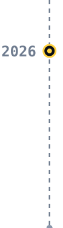
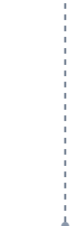

  <picture>
    <source media="(max-width: 900px)" srcset="assets/header-mobile.svg" />
    
  </picture>

I build systems that leave the screen and run on real machines, and products that help people feel less alone.

## Projects

<picture><source media="(max-width: 1150px)" srcset="assets/timeline-2026-mobile.svg" /></picture><a href="https://github.com/Domy-MANS/insect-frass-vision"><picture><source media="(max-width: 1150px)" srcset="assets/card-vision-mobile.svg" /></picture></a>

<picture><source media="(max-width: 1150px)" srcset="assets/timeline-2025-top-mobile.svg" /></picture><a href="https://github.com/Domy-MANS/Us"><picture><source media="(max-width: 1150px)" srcset="assets/card-us-top-mobile.svg" width="92%" /></picture></a> <picture><source media="(max-width: 1150px)" srcset="assets/timeline-2025-mid-mobile.svg" /></picture><a href="https://github.com/Domy-MANS/Us"><picture><source media="(max-width: 1150px)" srcset="assets/card-us-left-mobile.svg" width="54%" /></picture></a><a href="https://domy-mans.github.io/Us/Us.html"><picture><source media="(max-width: 1150px)" srcset="assets/card-us-button-mobile.svg" width="34%" /></picture></a><a href="https://github.com/Domy-MANS/Us"><picture><source media="(max-width: 1150px)" srcset="assets/card-us-right-mobile.svg" width="4%" /></picture></a> <picture><source media="(max-width: 1150px)" srcset="assets/timeline-2025-bottom-mobile.svg" /></picture><a href="https://github.com/Domy-MANS/Us"><picture><source media="(max-width: 1150px)" srcset="assets/card-us-bottom-mobile.svg" width="92%" /></picture></a>

<picture><source media="(max-width: 1150px)" srcset="assets/timeline-mans-2025-top-mobile.svg" /></picture><a href="https://github.com/Domy-MANS/MANS"><picture><source media="(max-width: 1150px)" srcset="assets/card-mans-top-mobile.svg" width="92%" /></picture></a> <picture><source media="(max-width: 1150px)" srcset="assets/timeline-mans-2025-mid-mobile.svg" /></picture><a href="https://github.com/Domy-MANS/MANS"><picture><source media="(max-width: 1150px)" srcset="assets/card-mans-left-mobile.svg" width="54%" /></picture></a><a href="https://www.youtube.com/watch?v=gO6-Dt_JAZw"><picture><source media="(max-width: 1150px)" srcset="assets/card-mans-button-mobile.svg" width="34%" /></picture></a><a href="https://github.com/Domy-MANS/MANS"><picture><source media="(max-width: 1150px)" srcset="assets/card-mans-right-mobile.svg" width="4%" /></picture></a> <picture><source media="(max-width: 1150px)" srcset="assets/timeline-mans-2025-bottom-mobile.svg" /></picture><a href="https://github.com/Domy-MANS/MANS"><picture><source media="(max-width: 1150px)" srcset="assets/card-mans-bottom-mobile.svg" width="92%" /></picture></a>

