  <picture>
    <source media="(max-width: 900px)" srcset="assets/header-mobile.svg" />
    
  </picture>

I build systems that leave the screen and run on real machines, and products that help people feel less alone.

## Projects

<a href="https://github.com/Domy-MANS/insect-frass-vision">
  <picture>
    <source media="(max-width: 900px)" srcset="assets/project-vision-mobile.svg" />
    
  </picture>
</a>

<a href="https://domy-mans.github.io/Us/Us.html">
  <picture>
    <source media="(max-width: 900px)" srcset="assets/project-us-mobile.svg" />
    
  </picture>
</a>
