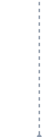

  <picture>
    <source media="(max-width: 900px)" srcset="assets/header-armor-mobile.svg" />
    
  </picture>

I build systems that leave the screen and run on real machines, and products that help people feel less alone.

## Projects

<picture><source media="(max-width: 1150px)" srcset="assets/timeline-yoa-2026-top-mobile.svg" /></picture><a href="https://github.com/Domy-MANS/you-owe-ai"><picture><source media="(max-width: 1150px)" srcset="assets/card-yoa-top-mobile.svg" width="92%" /></picture></a> <picture><source media="(max-width: 1150px)" srcset="assets/timeline-yoa-2026-mid-mobile.svg" /></picture><a href="https://github.com/Domy-MANS/you-owe-ai"><picture><source media="(max-width: 1150px)" srcset="assets/card-yoa-left-mobile.svg" width="54%" /></picture></a><a href="https://domy-mans.github.io/you-owe-ai/"><picture><source media="(max-width: 1150px)" srcset="assets/card-yoa-button-mobile.svg" width="34%" /></picture></a><a href="https://github.com/Domy-MANS/you-owe-ai"><picture><source media="(max-width: 1150px)" srcset="assets/card-yoa-right-mobile.svg" width="4%" /></picture></a> <picture><source media="(max-width: 1150px)" srcset="assets/timeline-yoa-2026-bottom-mobile.svg" /></picture><a href="https://github.com/Domy-MANS/you-owe-ai"><picture><source media="(max-width: 1150px)" srcset="assets/card-yoa-bottom-mobile.svg" width="92%" /></picture></a>

<picture><source media="(max-width: 1150px)" srcset="assets/timeline-vision-top-mobile.svg" /></picture><a href="https://github.com/Domy-MANS/insect-frass-vision"><picture><source media="(max-width: 1150px)" srcset="assets/card-vision-top-mobile.svg" width="92%" /></picture></a> <picture><source media="(max-width: 1150px)" srcset="assets/timeline-vision-mid-mobile.svg" /></picture><a href="https://github.com/Domy-MANS/insect-frass-vision"><picture><source media="(max-width: 1150px)" srcset="assets/card-vision-left-mobile.svg" width="54%" /></picture></a><a href="https://github.com/Domy-MANS/insect-frass-vision#live-demo"><picture><source media="(max-width: 1150px)" srcset="assets/card-vision-button-mobile.svg" width="34%" /></picture></a><a href="https://github.com/Domy-MANS/insect-frass-vision"><picture><source media="(max-width: 1150px)" srcset="assets/card-vision-right-mobile.svg" width="4%" /></picture></a> <picture><source media="(max-width: 1150px)" srcset="assets/timeline-vision-bottom-mobile.svg" /></picture><a href="https://github.com/Domy-MANS/insect-frass-vision"><picture><source media="(max-width: 1150px)" srcset="assets/card-vision-bottom-mobile.svg" width="92%" /></picture></a>

<picture><source media="(max-width: 1150px)" srcset="assets/timeline-balance-car-top-mobile.svg" /></picture><a href="https://github.com/Domy-MANS/balance-car-learning"><picture><source media="(max-width: 1150px)" srcset="assets/card-balance-top-mobile.svg" width="92%" /></picture></a> <picture><source media="(max-width: 1150px)" srcset="assets/timeline-balance-car-mid-mobile.svg" /></picture><a href="https://github.com/Domy-MANS/balance-car-learning"><picture><source media="(max-width: 1150px)" srcset="assets/card-balance-left-mobile.svg" width="54%" /></picture></a><a href="https://github.com/Domy-MANS/balance-car-learning#demo"><picture><source media="(max-width: 1150px)" srcset="assets/card-balance-button-mobile.svg" width="34%" /></picture></a><a href="https://github.com/Domy-MANS/balance-car-learning"><picture><source media="(max-width: 1150px)" srcset="assets/card-balance-right-mobile.svg" width="4%" /></picture></a> <picture><source media="(max-width: 1150px)" srcset="assets/timeline-balance-car-bottom-mobile.svg" /></picture><a href="https://github.com/Domy-MANS/balance-car-learning"><picture><source media="(max-width: 1150px)" srcset="assets/card-balance-bottom-mobile.svg" width="92%" /></picture></a>

<picture><source media="(max-width: 1150px)" srcset="assets/timeline-mans-top-mobile.svg" /></picture><a href="https://github.com/Domy-MANS/MANS"><picture><source media="(max-width: 1150px)" srcset="assets/card-mans-top-mobile.svg" width="92%" /></picture></a> <picture><source media="(max-width: 1150px)" srcset="assets/timeline-mans-mid-mobile.svg" /></picture><a href="https://github.com/Domy-MANS/MANS"><picture><source media="(max-width: 1150px)" srcset="assets/card-mans-left-mobile.svg" width="54%" /></picture></a><a href="https://www.youtube.com/watch?v=gO6-Dt_JAZw"><picture><source media="(max-width: 1150px)" srcset="assets/card-mans-button-mobile.svg" width="34%" /></picture></a><a href="https://github.com/Domy-MANS/MANS"><picture><source media="(max-width: 1150px)" srcset="assets/card-mans-right-mobile.svg" width="4%" /></picture></a> <picture><source media="(max-width: 1150px)" srcset="assets/timeline-mans-bottom-mobile.svg" /></picture><a href="https://github.com/Domy-MANS/MANS"><picture><source media="(max-width: 1150px)" srcset="assets/card-mans-bottom-mobile.svg" width="92%" /></picture></a>

<picture><source media="(max-width: 1150px)" srcset="assets/timeline-us-app-top-mobile.svg" /></picture><a href="https://github.com/Domy-MANS/Us"><picture><source media="(max-width: 1150px)" srcset="assets/card-us-top-mobile.svg" width="92%" /></picture></a> <picture><source media="(max-width: 1150px)" srcset="assets/timeline-us-app-mid-mobile.svg" /></picture><a href="https://github.com/Domy-MANS/Us"><picture><source media="(max-width: 1150px)" srcset="assets/card-us-left-mobile.svg" width="54%" /></picture></a><a href="https://domy-mans.github.io/Us/Us.html"><picture><source media="(max-width: 1150px)" srcset="assets/card-us-button-mobile.svg" width="34%" /></picture></a><a href="https://github.com/Domy-MANS/Us"><picture><source media="(max-width: 1150px)" srcset="assets/card-us-right-mobile.svg" width="4%" /></picture></a> <picture><source media="(max-width: 1150px)" srcset="assets/timeline-us-app-bottom-mobile.svg" /></picture><a href="https://github.com/Domy-MANS/Us"><picture><source media="(max-width: 1150px)" srcset="assets/card-us-bottom-mobile.svg" width="92%" /></picture></a>

