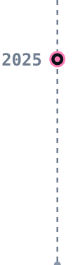

  <picture>
    <source media="(max-width: 900px)" srcset="assets/header-mobile.svg" />
    
  </picture>

I build systems that leave the screen and run on real machines, and products that help people feel less alone.

## Projects

<picture><source media="(max-width: 900px)" srcset="assets/timeline-2026-mobile.svg" /></picture><a href="https://github.com/Domy-MANS/insect-frass-vision"><picture><source media="(max-width: 900px)" srcset="assets/card-vision-mobile.svg" /></picture></a>

<picture><source media="(max-width: 900px)" srcset="assets/timeline-2025-mobile.svg" /></picture><a href="https://domy-mans.github.io/Us/Us.html"><picture><source media="(max-width: 900px)" srcset="assets/card-us-mobile.svg" /></picture></a>

